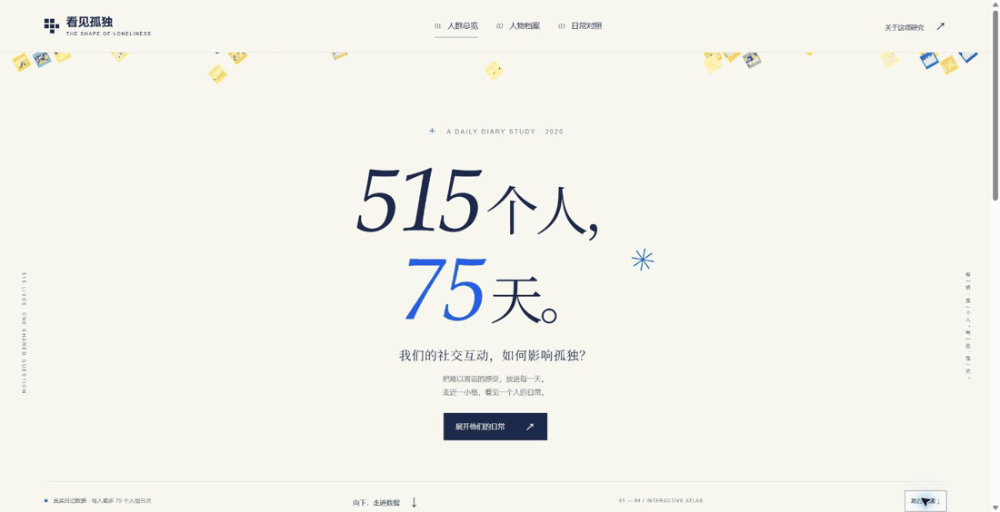
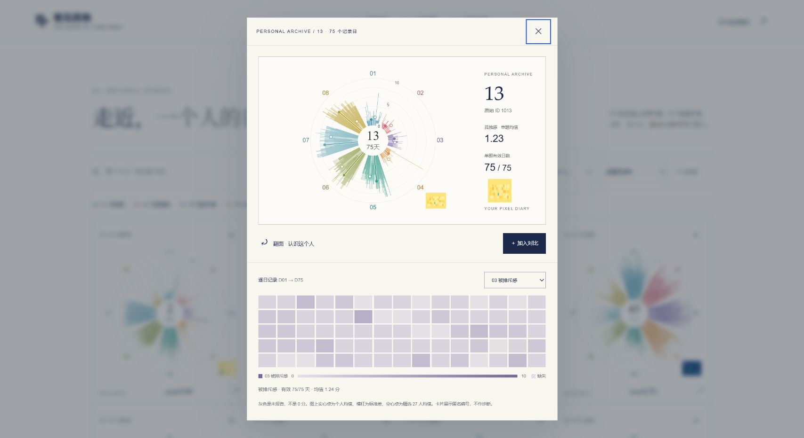
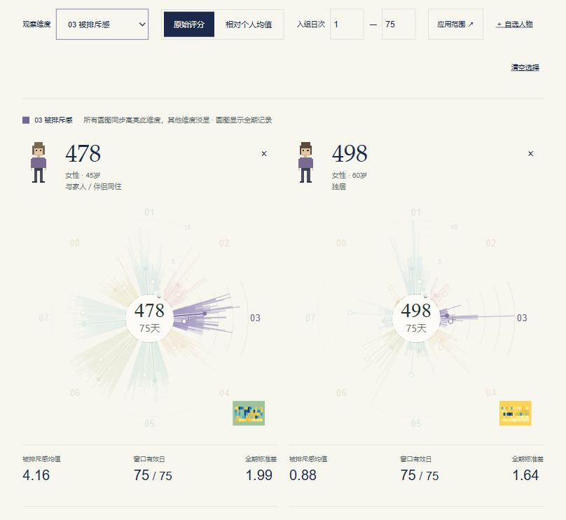

# 看见孤独 · 515个人，75天

从人群总览走进人物日记，再自由选人对比的静态数据叙事网站。无运行时第三方依赖，无追踪器，无远程 API，无构建步骤；所有图表在浏览器本地渲染。

## 预览


手机首屏与翻面档案见 [手机首屏](docs/preview-mobile.png)、[人物档案卡](docs/preview-profile.png)。

### 掉落动画预览



GIF 为真实浏览器采样帧的循环预览；网页本身只自动播放一次，不持续循环。

## 独立 HTML 下载

仓库根目录的 [standalone.html](standalone.html) 是已内置全部数据、样式、脚本和海报的圆图修正版，下载后可作为单文件使用；无需同时下载 assets 或 data 文件夹。文件约24.7 MB，GitHub可能不提供源码预览，请使用下载按钮。

## 本地运行

需要 Node.js 20 或更新版本，无需 `npm install`。

```sh
npm start
```

打开 `http://127.0.0.1:4173`。也可用其他静态 HTTP 服务器。不要直接双击 HTML（浏览器对本地模块和 fetch 的限制会阻止加载）。

```sh
npm test
npm run check
```

## 交互

- **首屏**：`515个人，75天。`，真实 515 人数据格围绕标题；首次进入时错落掉下、轻转、回弹停稳，约 3 秒结束。右下角可跳过或重播；减少动态效果偏好下保持静态。落下过程对标题区域作排除裁剪，不遮住文字；停稳后点格子仍打开原人物档案。
- **总览**：515 个原始矢量热力格，100%—400% 缩放，人物/逐日矩阵切换。悬停看放大预览；点选跳转档案；Shift 点选加入对比。方向键在格子间移动，Enter 打开。
- **档案**：原海报 27 人的圆形图；中心展示编号为原始 ID − 1000，例 `1122 → 122`；右下角嵌入总览同一个 ID 的热力格。可以按展示编号或原始 ID 搜索，也可切换全部 515 人（分页）。
- **翻卡**：图形正面/基线人物资料背面，按编号生成的像素示意小人；支持点击或键盘翻面、Escape、原生 dialog 焦点约束与减少动态效果偏好。
- **对照**：选择 2—4 人；八维指标、指定日次窗口（点“应用范围”或按 Enter）、原始/个人均值偏离轨迹、同分分层。包含两组海报预设（1478/1498 与 1113/1045）。
- **海报**：四份对应海报的全尺寸矢量 SVG 查看、放大和下载；后两张保留原稿中的 AI 示意人物图片与原有说明，它们不是参与者真实肖像。
- **分享**：状态保存在 hash URL；数据处理全部留在本机。例 `#archives?person=1122&flip=1`、`#compare?ids=1478,1498&metric=6&align=centered&start=10&end=40`。

## 数据口径（重要）

来源为用户指定的 `0039_kuczynski_ts(1).csv`、`DailyDiary(1).csv`、`Baseline(1)(1).csv`。仓库不包含这些原始 CSV 或心理诊断字段；仅包含所需匿名 ID、日记指标、年龄/性别/收入/居住/婚恋/子女状况。

1. 原始时间序列与日记各 **28,027 条**，**515 人**；基线表 515 行。
2. D01—D75 是**每个人入组后的日次**，不是同一自然日，不意味着所有人都有 75 个有效日。
3. **总览热力格**：`(loneliness + left_out) / 2`，两题必须同时有效；同人同日重复记录取均值。75 天窗口有效 **27,785** 格，缺失 **10,840** 格，合计 **38,625** 格。7 条额外重复记录合并；1 条 D76 记录不进入窗口。
4. **档案圆图与对比**：DailyDiary 八个原始单题，孤独感为 `loneliness`，**不是上述双题复合分**。按源文件 `(ID, date)` 对齐到时间序列表的 day；所有指标保留 0 分与缺失的区别。
5. 27 人圆图的空心点表示所选 27 人各自均值的等权平均；标准差使用样本标准差。原海报中 24 人记录 75 日、3 人记录 74 日。
6. 对照窗口只改变轨迹、窗口均值和分层；圆图与其标准差仍显示全期。个人均值偏离使用全期个人基线。
7. “年收入”的来源变量名为 income，币种美元；不额外推断其为个人/家庭收入。像素头像不是人物外貌推断。
8. 同分层、相关和个案差异都是描述性结果。不作诊断、显著性或因果推断，不代表机器人产品效果。

`data/audit.json` 记录来源 SHA-256 和核对计数。`tests/data.test.mjs` 核对样本、缺失、均值/标准差、预设数值、ID 映射、URL、边界日次与 SVG 关联。

## 源稿与 Figma

已通过浏览器打开指定 Figma 实时文件并核对页面与图层。Figma 全帧“复制为 SVG”因体积过大失败后，使用第一张画板已有的 PDF 导出设置下载了 **实时总览海报**。`assets/poster-1.pdf` 是未经改写的下载原件，`assets/poster-1.svg` 由该 PDF 转为矢量 SVG，文字轮廓化以保留字形。

网页的 515 个矢量格子与 27 人圆图复用工作区中对应的可编辑源图，不是从截图临摹；按原始 ID 联动。第二张网页和下载 SVG 均修改展示编号并加上对应热力格；后两张使用“人物图片版”本地源稿。没有修改 Figma 云端视觉内容。

实时 Figma：
https://www.figma.com/design/OvfeXkNGuYmqbaycS1LDtK/?node-id=92-8

复现数据与图形资源（Python 标准库，无额外依赖）：

```sh
python scripts/build_data.py --source "原始CSV所在目录" --artwork "原工作区目录"
```

`--artwork` 目录中需有原 `sorted_tiles_compact.svg`、`sorted_tiles_positions.json` 以及原海报输出文件夹；第一张实时海报沿用仓库中随附的 PDF/SVG。非本站部署所需；仓库已包含生成好的图形与数据。

## GitHub Pages

本项目无需构建。仓库 Settings → Pages → Build and deployment 中选择 **Deploy from a branch**，分支 `main`、目录 `/(root)`，保存后可在 `https://eleanor-wsyy.github.io/HTEL/` 查看。

这里只描述启用步骤，**并不表示 Pages 已启用或上述地址已验证上线**。全部资源使用相对路径，兼容项目子路径 `/HTEL/`。

## 设计来源与出处

- 用户提供的四张海报与 Figma 源稿；保留其研究出处及原有图例。
- 首屏参考：Giorgia Lupi / Pentagram 等为 **The New York Times** 创作的《1,374 Days: My Life with Long Covid》。借用数据标记围合标题与渐进式阅读方式，未复用其症状图形、文本或代码。
- 参考页：https://www.commarts.com/project/37550/1-374-days-my-life-with-long-covid
- 动效与交互参考：ThreeUI、OhWow、UI Skills；未复制它们的专有组件。
- 研究：Kuczynski, A. M., Halvorson, M. A., Slater, L. R., & Kanter, J. W. (2022; online 2021). The effect of social interaction quantity and quality on depressed mood and loneliness: A daily diary study. *Journal of Social and Personal Relationships, 39*(3), 734–756. https://doi.org/10.1177/02654075211045717

原始研究数据、海报与参考作品的权利归各自权利人；本项目不对第三方素材附加新的开放许可。

## 验证记录

- 36 项 Node 自动测试通过；JavaScript 语法检查通过。
- 11 项浏览器功能/响应式检查通过，详见 `docs/browser-checks.json`。
- 与原海报 27 人数值附表的 216 行指标逐项核对：有效日数、均值、样本标准差均一致，详见 `docs/source-validation.json`。

### 圆图颜色与热力色阶

圆图蓝绿色标识 01「孤独感」这一单题维度，分值大小通过径向长度表示。人物卡下方选择 01—08 任一指标后，逐日格子使用圆图对应指标的同一色相，以深浅表示 0—10 分。增加同色图例与 0—10 色阶；灰色斜纹标明缺失，与真实 0 分区分。总览双题复合分仍保留原色阶与原口径。

8 项指标、600 个实际日格已在浏览器逐一核对，详见 `docs/metric-color-checks.json`。




## 总览与档案细调（2026-10-26）

基于远端 `c7e0bcd2c8bde53b454014b2b443efe7cc744a58`；修改前完整目录树校验为 `486a0e7fce8cdfa3907790e5cdc6502a51aec851`，与远端一致。保留首页落下动画与八项单题热图的颜色更新。

- 总览移除人口统计侧栏，使用完整宽度；色带下增加真实人物格示例、15×5 日次读法、双题计算、缺失处理与默认排序说明。
- 总览默认按当前数据中 D01—D75 有效日双题均值严格降序，替代原稿位置顺序。全部缺失的参与者保留并排末尾。
- 总览与档案支持年龄、年龄优先加居住状况、美元年收入区间、居住分组加编号、婚恋分组加孤独均值、父母身份分组加孤独均值。排序不删除或平衡样本；缺失值在对应层级末尾，并列按编号。总览使用双题均值，档案使用单题均值。
- 父母身份合并有子女同住与不同住；婚恋与父母身份各自排序，避免将可能重叠的身份当成互斥类别。收入是原始区间，不推断精确工资。
- 档案八项指标图例改为对应色块，卡片显示当前排序所用背景信息。
- 对照页移除回应偏离散点。它原本表达个人内部同日共变；例如编号 309、449 的孤独感标准差均为 0，相关无法定义，散点退化为水平线。保留逐日轨迹、八指标均值与同分分层。
- `tests/sorting.test.mjs` 校验数值/缺失/并列顺序、收入区间顺序、身份组合、双题与单题口径以及所有参与者保留。


### 圆图读法与文案调整

- 删除首页标题旁的装饰星号；档案页简介从「8 个观察维度」开始。
- 在八色图例下增加默认展开、可收起的「圆图怎么读」面板，使用编号 478 的真实圆图。
- 说明同心圆刻度、逐日细线、实心个人均值点、均值 ± 1 个样本标准差线段、固定 27 人等权参考空心点；给出均值和样本标准差公式，并说明缺失与零分、记录日与有效日、单题与双题的区别。
- 浏览器确认星号不存在、简介文案正确、示例引用原图；展开收起正常，手机端无页面横向溢出。

### 对照圆图的指标同步高亮

对照页切换「观察维度」时，2—4 张人物圆图同时突出该指标原有颜色，其他扇区淡显。当前指标名称与色标同步更新；编号、中心信息和右下角总览格保留清晰显示。

精选人物的圆图通过叠层裁剪原始 SVG 实现高亮，不重画数据路径、不改变尺度；全部参与者的动态圆图也支持相同高亮。圆图仍显示全期记录，时间窗口只影响原有的窗口统计与轨迹。

8 项指标在两张原图中的同步切换已通过浏览器检查，详见 `docs/compare-focus-checks.json`。



## 交互优化与独立 HTML 交付

保留原有白底卡片、像素头像、数据色与海报源图，本轮新增：

- 人物卡默认「01 孤独感」，总览双题复合分保留为明确标注的可选项。
- 对比页固定工具栏，分为日常轮廓、逐日变化、同分对照；支持突出所选/显示全部。参考环与0/5/10刻度保持清楚。
- 总览按完整范围适配，支持中心缩放、拖拽平移、聚焦人物、返回原来的排序/缩放/视野；拖拽松手不误开卡片。
- 卡片文字可复制，只有按钮和留白处翻面；逐日格支持悬停/点击读数，一键查看75天。长资料卡自动撑高。
- 手机端保留并排数值摘要，可选并排圆图或单张放大；设置可折叠，首屏不再显示遮挡底部的选人浮条。
- 增加来源可复核的515→192→27筛选说明：按提交记录日数筛选，不混作单项有效日数。

生成独立文件（仅需Python标准库）：

```sh
python scripts/build_standalone.py --output dist/loneliness-atlas.html
```

该文件内置全部数据、CSS、JavaScript、515个矢量格、27个原始圆图和四张矢量海报，无外部脚本/样式/图形依赖。生成文件包含源码摘要；测试会检查是否为当前源码，防止交付旧副本。`dist/` 不提交Git。

本轮46项自动测试通过（包含已生成独立文件的检查），16项交互/响应式浏览器检查通过，见 `docs/interaction-upgrade-checks.json`。浏览器工具禁止 `file://`，没有通过其他方式绕过；验收使用同一独立HTML的本地HTTP预览，另以静态检查确认无网络加载器及资源依赖。直接双击仍需在用户浏览器确认。

### 圆图裁切修复

桌面人物卡的图表网格行使用 `minmax(0,1fr)`，SVG同时约束宽高并保持 `xMidYMid meet`，不再由固有正方形宽度撑高而被卡片裁掉。正反两面均纳入内容高度检查；已在截图尺寸、短屏和手机共10个案例验证，见 `docs/card-circle-fit-checks.json`。

### 局外人：低观测覆盖的日常

新增 `#outsiders` 页面，基于主分支 `53bc005`，保留既有交互与单文件构建。

- 默认筛选总览双题有效日 ≤15/75（覆盖率≤20%，至少60个灰格），得到49人，其余466人；这是可解释的探索性门槛，不是公认统计阈值或原研究排除规则。
- 可切换≤7天（32人）与≤30天（91人）；通过URL参数 `threshold` 分享，筛选不依据人口属性或孤独分数。
- 使用 `heat` 中非缺失日计数，包含零分与零有效日者。它与提交过日记的天数不同，例如编号108有66个记录日但仅9个双题有效日；不能把灰格解释为主动退出。
- 展示全体有效日分布，并对比性别、年龄、年收入区间、居住、婚恋、子女情况。组内比例包含未报告项，差值按百分点计算；不作显著性或因果断言。
- 背景属性不另设色相：实心/空心标记区分低覆盖组与其余人。人物格子直接复用原有SVG数据符号，缺失灰色、孤独分色阶均不变。
- 点击每个格子可在当前页打开原有档案并翻面，关闭后保持门槛、滚动位置和键盘焦点。页首提供直达人物格子按钮。
- 新增5项覆盖统计/路由/颜色复用测试，单文件构建包含新增模块与源码哈希。
