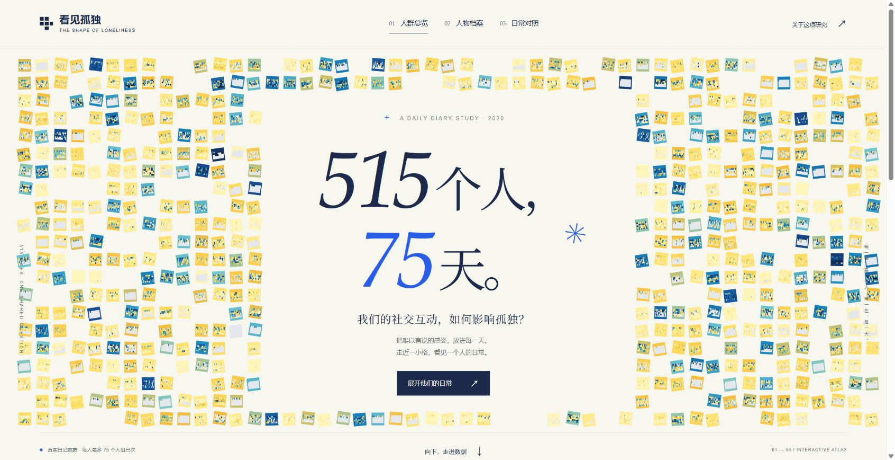

# 看见孤独 · 515个人，75天

从人群总览走进人物日记，再自由选人对比的静态数据叙事网站。无运行时第三方依赖，无追踪器，无远程 API，无构建步骤；所有图表在浏览器本地渲染。

## 预览



手机首屏与翻面档案见 [手机首屏](docs/preview-mobile.png)、[人物档案卡](docs/preview-profile.png)。

## 本地运行

需要 Node.js 20 或更新版本，无需 `npm install`。

```sh
npm start
```

打开 `http://127.0.0.1:4173`。也可用其他静态 HTTP 服务器。不要直接双击 HTML（浏览器对本地模块和 fetch 的限制会阻止加载）。

```sh
npm test
npm run check
```

## 交互

- **首屏**：`515个人，75天。`，真实 515 人数据格围绕标题；点格子直接打开对应档案。
- **总览**：515 个原始矢量热力格，100%—400% 缩放，人物/逐日矩阵切换。悬停看放大预览；点选跳转档案；Shift 点选加入对比。方向键在格子间移动，Enter 打开。
- **档案**：原海报 27 人的圆形图；中心展示编号为原始 ID − 1000，例 `1122 → 122`；右下角嵌入总览同一个 ID 的热力格。可以按展示编号或原始 ID 搜索，也可切换全部 515 人（分页）。
- **翻卡**：图形正面/基线人物资料背面，按编号生成的像素示意小人；支持点击或键盘翻面、Escape、原生 dialog 焦点约束与减少动态效果偏好。
- **对照**：选择 2—4 人；八维指标、指定日次窗口（点“应用范围”或按 Enter）、原始/个人均值偏离轨迹、同分分层、回应偏离散点。包含两组海报预设（1478/1498 与 1113/1045）。
- **海报**：四份对应海报的全尺寸矢量 SVG 查看、放大和下载；后两张保留原稿中的 AI 示意人物图片与原有说明，它们不是参与者真实肖像。
- **分享**：状态保存在 hash URL；数据处理全部留在本机。例 `#archives?person=1122&flip=1`、`#compare?ids=1478,1498&metric=6&align=centered&start=10&end=40`。

## 数据口径（重要）

来源为用户指定的 `0039_kuczynski_ts(1).csv`、`DailyDiary(1).csv`、`Baseline(1)(1).csv`。仓库不包含这些原始 CSV 或心理诊断字段；仅包含所需匿名 ID、日记指标、年龄/性别/收入/居住/婚恋/子女状况。

1. 原始时间序列与日记各 **28,027 条**，**515 人**；基线表 515 行。
2. D01—D75 是**每个人入组后的日次**，不是同一自然日，不意味着所有人都有 75 个有效日。
3. **总览热力格**：`(loneliness + left_out) / 2`，两题必须同时有效；同人同日重复记录取均值。75 天窗口有效 **27,785** 格，缺失 **10,840** 格，合计 **38,625** 格。7 条额外重复记录合并；1 条 D76 记录不进入窗口。
4. **档案圆图与对比**：DailyDiary 八个原始单题，孤独感为 `loneliness`，**不是上述双题复合分**。按源文件 `(ID, date)` 对齐到时间序列表的 day；所有指标保留 0 分与缺失的区别。
5. 27 人圆图的空心点表示所选 27 人各自均值的等权平均；标准差使用样本标准差。原海报中 24 人记录 75 日、3 人记录 74 日。
6. 对照窗口只改变轨迹、窗口均值和分层；圆图与其标准差仍显示全期。个人均值偏离使用全期个人基线。
7. “年收入”的来源变量名为 income，币种美元；不额外推断其为个人/家庭收入。像素头像不是人物外貌推断。
8. 同分层、相关和个案差异都是描述性结果。不作诊断、显著性或因果推断，不代表机器人产品效果。

`data/audit.json` 记录来源 SHA-256 和核对计数。`tests/data.test.mjs` 核对样本、缺失、均值/标准差、预设数值、ID 映射、URL、边界日次与 SVG 关联。

## 源稿与 Figma

已通过浏览器打开指定 Figma 实时文件并核对页面与图层。Figma 全帧“复制为 SVG”因体积过大失败后，使用第一张画板已有的 PDF 导出设置下载了 **实时总览海报**。`assets/poster-1.pdf` 是未经改写的下载原件，`assets/poster-1.svg` 由该 PDF 转为矢量 SVG，文字轮廓化以保留字形。

网页的 515 个矢量格子与 27 人圆图复用工作区中对应的可编辑源图，不是从截图临摹；按原始 ID 联动。第二张网页和下载 SVG 均修改展示编号并加上对应热力格；后两张使用“人物图片版”本地源稿。没有修改 Figma 云端视觉内容。

实时 Figma：
https://www.figma.com/design/OvfeXkNGuYmqbaycS1LDtK/?node-id=92-8

复现数据与图形资源（Python 标准库，无额外依赖）：

```sh
python scripts/build_data.py --source "原始CSV所在目录" --artwork "原工作区目录"
```

`--artwork` 目录中需有原 `sorted_tiles_compact.svg`、`sorted_tiles_positions.json` 以及原海报输出文件夹；第一张实时海报沿用仓库中随附的 PDF/SVG。非本站部署所需；仓库已包含生成好的图形与数据。

## GitHub Pages

本项目无需构建。仓库 Settings → Pages → Build and deployment 中选择 **Deploy from a branch**，分支 `main`、目录 `/(root)`，保存后可在 `https://eleanor-wsyy.github.io/HTEL/` 查看。

这里只描述启用步骤，**并不表示 Pages 已启用或上述地址已验证上线**。全部资源使用相对路径，兼容项目子路径 `/HTEL/`。

## 设计来源与出处

- 用户提供的四张海报与 Figma 源稿；保留其研究出处及原有图例。
- 首屏参考：Giorgia Lupi / Pentagram 等为 **The New York Times** 创作的《1,374 Days: My Life with Long Covid》。借用数据标记围合标题与渐进式阅读方式，未复用其症状图形、文本或代码。
- 参考页：https://www.commarts.com/project/37550/1-374-days-my-life-with-long-covid
- 动效与交互参考：ThreeUI、OhWow、UI Skills；未复制它们的专有组件。
- 研究：Kuczynski, A. M., Halvorson, M. A., Slater, L. R., & Kanter, J. W. (2022; online 2021). The effect of social interaction quantity and quality on depressed mood and loneliness: A daily diary study. *Journal of Social and Personal Relationships, 39*(3), 734–756. https://doi.org/10.1177/02654075211045717

原始研究数据、海报与参考作品的权利归各自权利人；本项目不对第三方素材附加新的开放许可。

## 验证记录

- 19 项 Node 自动测试通过；JavaScript 语法检查通过。
- 9 项浏览器功能/响应式检查通过，详见 `docs/browser-checks.json`。
- 与原海报 27 人数值附表的 216 行指标逐项核对：有效日数、均值、样本标准差均一致，详见 `docs/source-validation.json`。
